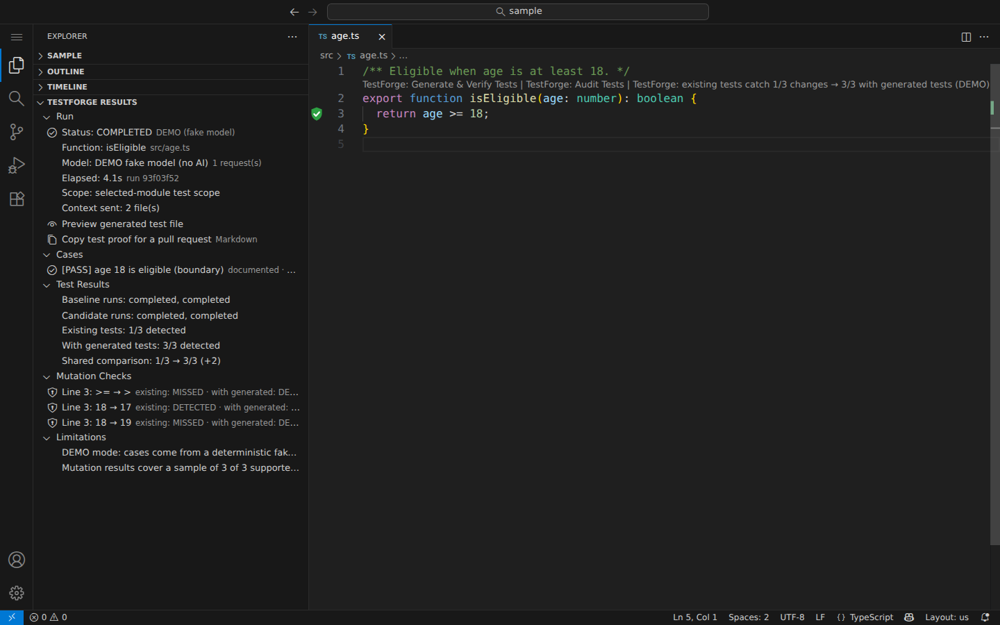

# TestForge

**AI writes your tests. Who tests the tests?**

TestForge is a VS Code extension that proves whether tests catch bugs. It makes small changes to one exported TypeScript function (mutations such as `>=` → `>`), runs your real tests against each one, and shows which changes would ship unnoticed. Then it can propose Vitest tests that close those gaps, grounded in your docs and existing tests, and verify that they do.

- **Audit Existing Tests (no AI):** a mutation score for the tests you already have.
- **Generate & Verify Tests:** a language model returns test cases as **data only**. TestForge validates them, renders the tests from a fixed template, runs them against your code and scores them. Surviving mutations get one more targeted request (improvement pass).
- **Possible bugs:** when a case backed by your docs fails against the code, TestForge warns on the function instead of "fixing" the test.
- **In the editor:** gutter markers for protected and exposed lines, a score CodeLens, and possible-bug warnings.
- **For coding agents:** two Copilot agent-mode tools (`#testforgeAudit`, `#testforge`), so an agent can check its own tests and fix what survives.
- **For pull requests:** **Copy Test Proof** puts a Markdown before/after table on the clipboard.

All numbers come from real `tsc` and Vitest runs on temporary copies of your code. Nothing is written to your workspace until you click **Apply**.



## The one-click flow

1. Open a `.ts` file. Above an exported function, click **TestForge: Audit Tests** or **TestForge: Generate & Verify Tests**.
2. Approve the consent dialog. It lists the files that would be sent (none for an audit) and warns that code will be executed.
3. Read the **TestForge Results** view (Explorer) and the markers in the editor: for example "existing tests catch 1/3 changes → 3/3 with generated tests".
4. **Preview Generated Tests**, then **Apply Tests**. This creates `<module>.testforge.<runId>.test.ts` next to the module and never overwrites a file.

See [docs/demo.md](docs/demo.md) for the full demo, including agent mode.

## Install

```sh
npm ci && npm run package          # builds testforge.vsix
code --install-extension testforge.vsix
```

CI also builds the VSIX on every pull request (artifact `testforge-vsix`).

## Prerequisites for a target project

- One package per workspace folder (ESM or CommonJS) with a lockfile (`package-lock.json`, `pnpm-lock.yaml`, `yarn.lock`, `bun.lock` or `bun.lockb`)
- `vitest` 5.x and `typescript` 6.x or 7.x **already installed** locally. TestForge never installs packages
- Node.js ≥ 22.12.0 on `PATH` (or set `testforge.nodePath`)
- A trusted workspace
- For Generate & Verify: a model available through VS Code's Language Model API (for example GitHub Copilot), **or** use **Run Demo**, which uses a labeled fake model and needs no AI

The full list is in [docs/support-matrix.md](docs/support-matrix.md).

## Commands

| Command | What it does |
|---|---|
| TestForge: Audit Existing Tests (no AI) | Mutation-checks the function's existing tests. No model, no generated file |
| TestForge: Generate & Verify Tests | Runs the full flow for the function under the cursor. If that is ambiguous, it asks you to pick one |
| TestForge: Run Demo (fake model, no AI) | Same flow with a deterministic fake provider. Reports are labeled DEMO |
| TestForge: Copy Test Proof (Markdown) | Copies the selected run as GitHub Markdown for a pull request |
| TestForge: Select Model | Picks the language model to use |
| TestForge: Cancel Run | Cancels the active run and kills its processes |
| TestForge: Open Report | Opens a saved report (also works in Restricted Mode) |
| TestForge: Preview Generated Tests | Shows the generated file read-only |
| TestForge: Apply Tests | Creates the test file. Disabled when results are stale or a case fails |
| TestForge: Apply Failing Candidate | Applies cases that fail against the current code, after a confirmation |
| TestForge: Discard Run | Removes the current report |
| TestForge: Clear History | Deletes all saved reports for this workspace |

## Chat tools (Copilot agent mode)

| Tool | Reference | What it returns |
|---|---|---|
| `testforge_auditTests` | `#testforgeAudit` | The existing tests' score, each surviving change, and which test file to extend |
| `testforge_generateAndVerify` | `#testforge` | Generated cases, before/after scores and survivors. Tests are not applied |

Both take `{ filePath, functionName? }`. VS Code's confirmation for each call names the function, the files and the model, and is the consent. Tools never write to the workspace.

## Settings

| Setting | Default | Meaning |
|---|---|---|
| `testforge.editorInsights` | `true` | Gutter markers, score CodeLens and possible-bug warnings for the latest run |
| `testforge.nodePath` | `""` | Node.js executable. Empty means search `PATH` |
| `testforge.mutationSample` | `8` | Mutations to check (1–20), spread over the function |
| `testforge.globalDeadlineSeconds` | `180` | Overall run deadline (30–600) |
| `testforge.requirementsFile` | `""` | **Placeholder, not used yet** |

## Limitations

- **Temporary copies are not a sandbox.** Your code and tests run as you. See [docs/privacy.md](docs/privacy.md).
- One exported function at a time: named functions and `const` arrow functions, sync or async. Classes, methods, default exports, generators and type parameters are not supported.
- Mutations are hypothetical faults, not bugs, and each run checks a sample (8 by default). Some mutations cannot be detected by any test (equivalent mutants).
- Secret detection is best-effort.
- Tested in CI on Linux, macOS and Windows, including a real VS Code. A live model run and agent mode are checked by hand.

## Docs

[Architecture](docs/architecture.md) · [Decisions](docs/decisions.md) · [Support matrix](docs/support-matrix.md) · [Privacy & execution](docs/privacy.md) · [Demo](docs/demo.md) · [Development](docs/development.md) · [Progress](docs/progress.md) · [Plan](docs/plan.md)

License: MIT.
