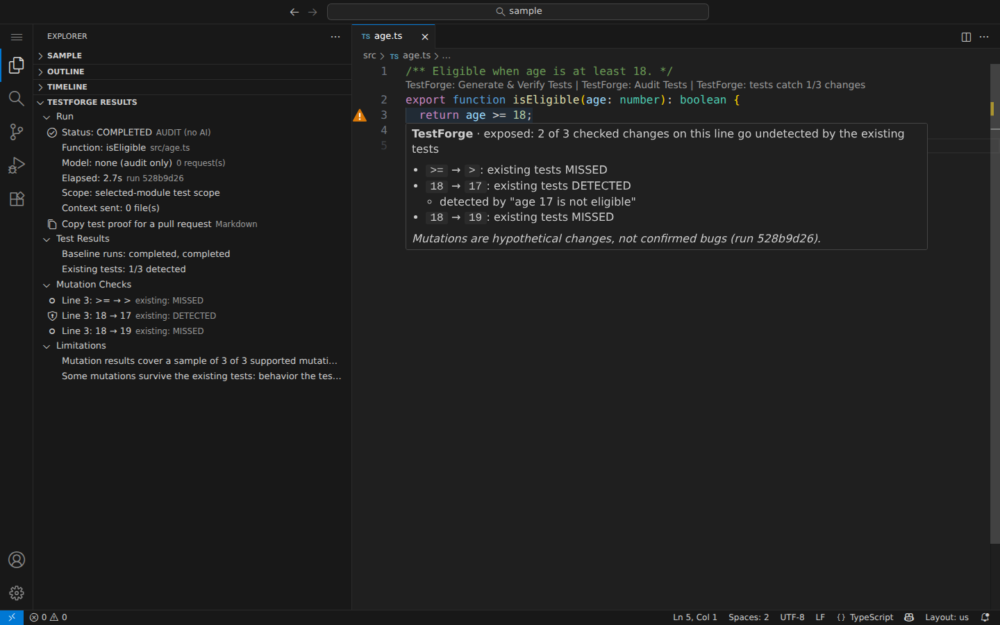
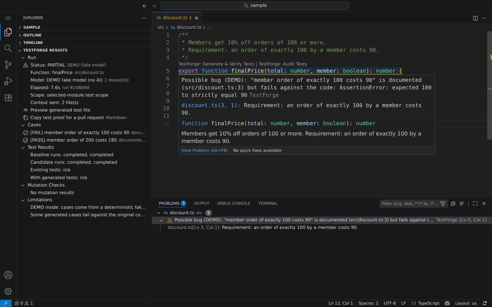

# Demo

The demos use `fixtures/sample`, an npm ESM project with pinned Vitest 5.0.2 and TypeScript 7.0.2. Run `npm run fixtures:install` first, then open `fixtures/sample` in the Extension Development Host (F5 from this repo) and trust the workspace.

The story in one line: **AI writes your tests. TestForge tests the tests.**

## 1. Audit: how good are the existing tests? (no AI)

`src/age.ts`:

```ts
/** Eligible when age is at least 18. */
export function isEligible(age: number): boolean {
  return age >= 18;
}
```

The existing tests in `src/age.test.ts` check 17 → false and 25 → true. They miss the boundary.

1. Open `src/age.ts` and click **TestForge: Audit Tests** above `isEligible`. Approve the execution-only consent (asked once per workspace).
2. Result: **Existing tests: 1/3 detected**. TestForge changed the code three ways (`>=` → `>`, `18` → `17`, `18` → `19`) and ran the real tests against each change. Only `18` → `17` made a test fail. The other two would ship unnoticed.
3. In the editor, line 3 gets an "exposed" gutter marker. Hover the code on line 3 (not the marker) to see which changes were missed.



## 2. Generate & Verify: tests that are proven to catch bugs

1. Click **TestForge: Generate & Verify Tests** above `isEligible`, or run **TestForge: Run Demo (fake model, no AI)** for a deterministic run labeled `DEMO`.
2. Progress: preflight → baseline (2 runs) → generating → validating candidates (2 runs) → mutation checks → improvement pass (only when changes survive).
3. Expected result in **TestForge Results**:
   - One accepted case: `age 18 is eligible (boundary)`, basis `documented`, with the doc comment as evidence.
   - `Existing tests: 1/3 detected`, `With generated tests: 3/3 detected`, `Shared comparison: 1/3 → 3/3 (+2)`.
   - In the editor: the CodeLens **TestForge: existing tests catch 1/3 changes → 3/3 with generated tests**, and line 3 turns "protected".
4. **Preview Generated Tests** shows the file read-only. **Apply Tests** creates `src/age.testforge.<runId>.test.ts` and never overwrites a file.
5. **Copy Test Proof (Markdown)** (Results view title menu or the Run group) copies a before/after table and the mutation results for a pull request.


All numbers come from real `tsc` and Vitest runs on temporary copies. Nothing is written to the project before Apply.

## 3. Possible bug: the docs and the code disagree

`src/discount.ts` documents "an order of exactly 100 by a member costs 90", but the code uses `total > 100`.

1. Run the demo on `finalPrice`.
2. The documented case fails against the code. TestForge keeps it for review (status `partial`, no mutation scores) and shows a warning on `finalPrice`: **Possible bug (DEMO): "member order of exactly 100 costs 90" is documented (src/discount.ts:3) but fails against the code**. The related information points at the documented line.
3. The proof's **Possible bugs** section lists it. Applying it needs **Apply Failing Candidate**.



## 4. Agent mode: the coding agent checks its own tests

Needs GitHub Copilot (or another chat provider) in agent mode. Not run in CI.

1. In the chat, ask: "Use #testforgeAudit to check the tests of isEligible in src/age.ts, then fix what it finds."
2. VS Code shows TestForge's confirmation (function, files, "runs your code"). Allow it.
3. The tool answers with the score, each surviving change (`line 3: >= → >`, `line 3: 18 → 19`) and a next step: add cases to `src/age.test.ts` that fail under each survivor.
4. The agent adds the 18 and 19 cases and calls the tool again: 3/3 detected.

`#testforge` (`testforge_generateAndVerify`) runs Generate & Verify the same way; the user still applies the tests.

## Measured timing

Fake provider, pipeline only, Node 22.22.2, Linux x64 cloud container, 2026-10-12. A live model adds its own response time.

| Function | Mode | Status | Time | Result |
|---|---|---|---|---|
| `isEligible` | generate | completed | 4.8 s | existing 1/3 → with generated 3/3 |
| `isEligible` | audit | completed | 3.0 s | existing 1/3, no model request |
| `finalPrice` | generate | partial (possible bug) | 2.6 s | not scored |
| `parseScore` (async) | generate | completed | 9.2 s | existing 1/8 → with generated 8/8 |
| `clamp` | generate | completed | 9.3 s | 7/8; the improvement pass added 2 cases that caught 2 of 3 survivors |
| `joinWords` | generate | completed | 1.3 s | N/A, no supported mutations |
| `countDown` | generate | partial (timeout) | 15.3 s | not scored; stopped by the 15 s process deadline |
| `uploadName` (`fixtures/realistic`) | generate | completed | 8.5 s | 3/7 → 7/7 (1 excluded) |
| `remainingQuota` (`fixtures/realistic`) | generate | completed | 14.5 s | 3/8 → 5/8, including 1 from the improvement pass |

## Fixtures

| File | Function | What it demonstrates |
|---|---|---|
| `sample/src/age.ts` | `isEligible` | The main demo: a missed boundary |
| `sample/src/discount.ts` | `finalPrice` | **Possible bug.** A documented case fails against the code; kept for review, needs **Apply Failing Candidate** |
| `sample/src/score.ts` | `parseScore` | **Async.** Resolves or rejects; the existing async test misses most boundaries |
| `sample/src/clamp.ts` | `clamp` | **No baseline, throws, improvement pass.** No existing test, so no before/after comparison; imports `./limits.js` |
| `sample/src/strings.ts` | `joinWords` | **No mutations.** Score N/A |
| `sample/src/slow.ts` | `countDown` | **Timeout.** A negative input loops forever; the process deadline stops it and the run is `partial` |
| `realistic/src/upload.ts` | `uploadName` | **Real-project shape.** CommonJS package, `node:path`, an installed package (`tiny-slug`), tests under `test/` |
| `realistic/src/quota.ts` | `remainingQuota` | Tests in `src/__tests__/` with `describe`, hooks, `it.each`, `it.skip`, `it.todo` and `vi.spyOn` |

The fake provider has canned cases only for these functions. Any other function gets zero cases.
